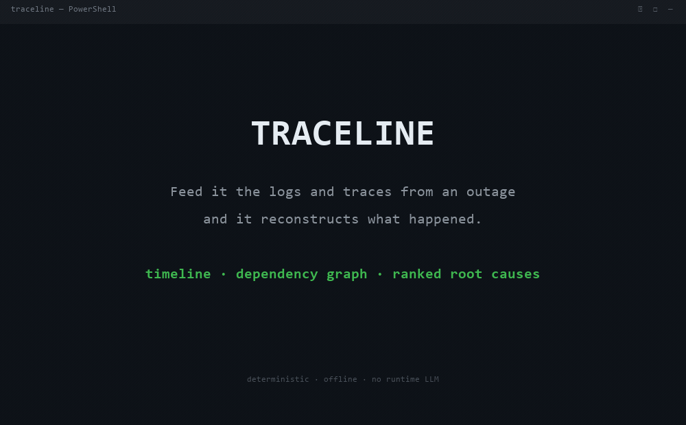
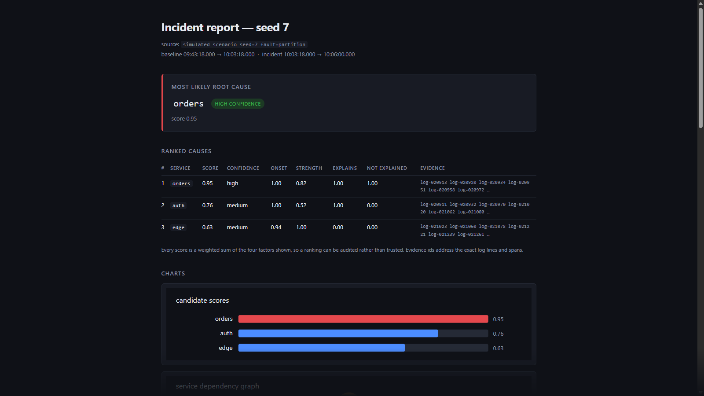

<p align="center">
  
</p>

<h1 align="center">Traceline</h1>

<p align="center">
  <b>Feed it the logs and traces from an outage and it reconstructs what happened.</b><br>
  A timeline, a dependency graph, and a ranked list of probable root causes with evidence.
</p>

<p align="center">
  <a href="LICENSE"></a>
  <a href="LICENSING.md"></a>
  
  
  
</p>

<p align="center">
  
  
  
  
</p>

<p align="center">
  
  
  
  
  
</p>

---

## Contents

- [Results](#results) · [Fixtures](#fixtures) · [Try it](#try-it)
- [Desktop app](#desktop-app) · [Commands](#commands) · [Output](#output)
- [How the ranking works](#how-the-ranking-works) · [Replay](#replay) · [Tuning](#tuning) · [Input format](#input-format)
- [Requirements](#requirements) · [Test](#test) · [Docs](#docs) · [License](#license)

<p align="center">
  
</p>

Symptoms are far from causes. A 500 in the edge service is three hops from a connection
pool that ran dry in a database proxy. Traceline reads the raw telemetry from the incident
window, detects which services actually changed behaviour, and ranks the candidates that
best explain what the rest of the system did.

Deterministic, offline, and explainable: no runtime LLM, no network, and the same input
always produces byte-identical output.

---

## Results

**Top-1 accuracy 97.0% · Top-3 100%** on 500 held-out seeded incidents never used for tuning
(95% interval ±1.5 points).

| Metric | Value |
|---|---|
| Evaluation seeds | 5000-5499 (frozen, disjoint from tuning) |
| Scenarios | 500 |
| Top-1 accuracy | **97.0% ± 1.5** |
| Top-3 accuracy | **100%** |
| True cause missing from candidates | 0 |
| Speed, spec volume (17k logs / 54k spans) | **0.75 s** |

Per fault type, top-1 ranges from 92.7% (`bad_deploy`) to 100% (`timeout_cascade`). The
scenarios include background noise on healthy services, a distractor service that is loud in
the logs without failing, and a transient error burst in the baseline — so "earliest anomaly"
is not a free win. Full tables in [`BENCHMARK.md`](BENCHMARK.md).

**On sample size.** An earlier version reported 100% on the 20-scenario held-out set. That
was arithmetically true and misleading: 20 scenarios cannot distinguish 90% from 100%, and
the interval was ±11 points. The 500-scenario set exists because the headline number needed
enough sample to mean something.

**Honest limitation.** The simulator is written by this same project. These numbers describe
how well the method recovers a cause from *this* generator's behaviour; they are not a claim
about real production systems.

## Fixtures

Three small captures are committed in [`fixtures/`](fixtures/README.md), each readable in a
minute and each proving one behaviour:

| Fixture | Proves |
|---|---|
| [`pool-exhaustion/`](fixtures/pool-exhaustion/) | names `db-proxy` (high confidence) ahead of the two services it broke |
| [`steady-state/`](fixtures/steady-state/) | returns **insufficient evidence** rather than inventing a cause |
| [`messy-input/`](fixtures/messy-input/) | four bad lines, four distinct rejection reasons, cause still found |

```bash
go run ./cmd/traceline analyze   --logs fixtures/pool-exhaustion/logs.jsonl   --spans fixtures/pool-exhaustion/spans.jsonl   --out out/pool
```

## Try it

```bash
make demo                      # simulate an incident, analyze it, write out/demo/
open out/demo/report.html      # self-contained report: no server, no network
```

Or against your own capture:

```bash
go run ./cmd/traceline analyze --logs logs.jsonl --spans spans.jsonl --out out/report
```

## Desktop app

A native window around the same pipeline: drop `logs.jsonl` and `spans.jsonl`,
press **Analyze**, read the ranked causes and the timeline on screen, then open
the HTML report. **Generate demo** runs a seeded incident when you have no
capture on hand.

```bash
cd gui && go build -o build/traceline-gui . && ./build/traceline-gui
```

It is a **separate module** (`gui/go.mod`) because a native window needs CGO and
the platform graphics stack, while the core must keep proving
`GOPROXY=off CGO_ENABLED=0 go build ./...`. The GUI imports the core through the
small public API in [`api.go`](api.go) — the same `analyze.Run` and
`report.WriteAll` the CLI calls, never a copy of them and never a shell-out to
the binary. A C toolchain is required; see [`gui/README.md`](gui/README.md) for
the per-OS packages.

## Requirements

- **Go 1.27** — that is the whole toolchain. No package manager, no virtualenv.
- Docker, only for the judge-style rebuild check.

There are **no third-party dependencies**: `go.mod` has no `require` block, and a test fails
if one ever appears.

## Output

One run produces, in the output directory:

| File | What it is |
|---|---|
| `report.html` | Self-contained report — inline CSS and SVG. Zero external requests, opens from `file://`. |
| `report.pdf` | The same report as a printable vector PDF (A4). |
| `charts/*.svg` | Each chart standalone: `error-rate.svg`, `timeline.svg`, `dependencies.svg`. |
| `summary.md` | Short Markdown summary for a postmortem. |
| `result.json` | Machine-readable ranked causes with evidence ids. |

<p align="center">
  
</p>

PNG is deliberately not produced **as a report artifact**: raster text needs a font renderer, and vector output is
crisper, diffable and golden-testable. Export from the browser if you need a raster.
See `docs/DECISIONS.md` D-002.

## Commands

```bash
go run ./cmd/traceline analyze  --logs l.jsonl --spans s.jsonl --out out/report
go run ./cmd/traceline simulate --seed 7 --out out/scenario
go run ./cmd/traceline bench    --seeds 1001-1020 --out BENCHMARK.md
go run ./cmd/traceline demo     --out out/demo --seed 7
go run ./cmd/traceline replay   --logs l.jsonl --spans s.jsonl --weights-a tuned.json
```

Installed as a binary, drop the `go run ./cmd/traceline` prefix.

`--open` on `analyze` and `demo` opens the generated report in your browser when
the run finishes. Exit codes: `0` success · `1` analysis failed or refused · `2`
usage error.

## Replay

The same capture, read two ways. `replay` runs the full pipeline twice — under two
sets of weights, or two incident windows — and diffs the two answers:

```bash
# Does the ranking depend on the weights?
traceline replay --logs l.jsonl --spans s.jsonl --weights-a aggressive.json

# Would a different incident window name a different cause?
traceline replay --logs l.jsonl --spans s.jsonl \
  --incident-start-a 2026-10-16T10:01:00Z \
  --incident-end-a   2026-10-16T10:05:00Z

# Write the comparison as Markdown for a postmortem
traceline replay --logs l.jsonl --spans s.jsonl --markdown out/replay.md
```

```
run A (A (weights custom.json)) vs run B (B (defaults))
  verdict  A: cause named   B: cause named   (unchanged)
  top-1    A: db-proxy      B: db-proxy      (unchanged)

  service          A            B
  api             #3 0.80      #3 0.65
  db-proxy        #1 1.00      #1 1.00
  web             #2 0.90      #2 0.75
```

This is analysis replay, not state rewind: it re-reads a capture, it does not
replay the system's behaviour. It answers a question a single run cannot — "how
much does my answer depend on my assumptions?"

## Tuning

The defaults live in [`rca_weights.json`](rca_weights.json), which is also the
documented starting point to copy and edit. A run with `--weights rca_weights.json`
is **byte-identical** to a run without it, and a test asserts exactly that.

Unknown keys and impossible values are rejected rather than ignored: a misspelled
threshold that silently left you on the defaults would let you attribute a result
to tuning you never applied.

## How the ranking works

Four factors, each normalized to `[0,1]`, combined with documented weights:

| Factor | Weight | Meaning |
|---|---|---|
| `onset` | 0.35 | Earlier relative to the window start scores higher |
| `strength` | 0.30 | Robust z-score of the strongest anomaly, on a log scale so a marginal signal cannot tie with a decisive one |
| `explains_downstream` | 0.25 | Fraction of its anomalous **dependents** whose onset it precedes |
| `not_explained` | 0.10 | 1.0 if no dependency of its own is anomalous and earlier |

Every candidate reports its full breakdown, so a ranking can be audited rather than trusted.
If nothing passes the anomaly threshold, the answer is **"insufficient evidence"** — never a
confident guess.

## Input format

Logs and spans are JSONL, one JSON object per line. Malformed lines are skipped and counted
by reason, never fatal.

```jsonc
// logs.jsonl
{"ts":"2026-10-16T10:00:01Z","service":"api-edge","level":"error","msg":"upstream timeout after 3000ms","trace_id":"a1b2c3","fields":{"route":"/checkout"}}

// spans.jsonl
{"trace_id":"a1b2c3","span_id":"s1","parent_span_id":null,"service":"api-edge","name":"GET /checkout","start":"2026-10-16T10:00:00Z","end":"2026-10-16T10:00:03Z","status":"error","attrs":{"http.status_code":500}}
```

## Test

```bash
make test           # full suite, offline, fast
make test-perf      # perf budget + scaling check (slow, machine-dependent)
make lint           # go vet + gofmt check
```

Both proofs that matter, run the way a reviewer runs them:

```bash
make test-offline   # GOPROXY=off CGO_ENABLED=0 — no module fetch, no C toolchain
make verify         # docker build + docker run --network none make test
```

`make test-offline` is the strong form of the offline claim: if any code path needed the
network, the build would fail before a single test ran.

## Docs

- [`docs/HANDOFF.md`](docs/HANDOFF.md) — current state, settled decisions, what is next. **Start here.**
- [`docs/DECISIONS.md`](docs/DECISIONS.md) — why Go, why no PNG, why this scope.
- [`docs/spec/spec.md`](docs/spec/spec.md) — requirements with acceptance criteria.
- [`docs/spec/plan.md`](docs/spec/plan.md) — architecture and package contracts.
- [`docs/spec/constitution.md`](docs/spec/constitution.md) — the non-negotiables.
- [`docs/spec/tasks.md`](docs/spec/tasks.md) — progress.
- [`LICENSING.md`](LICENSING.md) — what the AGPL allows, and when the commercial license matters.
- [`gui/README.md`](gui/README.md) — the desktop window, and why it is a second module.
- [`api.go`](api.go) — the public library API the GUI uses.
- [`docs/REAL-DATA-BENCHMARK.md`](docs/REAL-DATA-BENCHMARK.md) — how to validate against real incidents, and what would count as a win.
- [`rca_weights.json`](rca_weights.json) — the tuning file, with every default documented inline.

## License

**AGPL-3.0-or-later**, with a **commercial license available** for use the AGPL does not permit
(closed-source embedding, or hosting it as a service without publishing your modifications).

Internal and commercial *use* is free and unrestricted under the AGPL; the copyleft obligations
trigger on distribution and on offering it as a network service. The full text is in
[`LICENSE`](LICENSE); the practical explanation, including why this is not a
"non-commercial" license, is in [`LICENSING.md`](LICENSING.md).

Copyright © 2026 André Luiz Buzzo de Souza.
